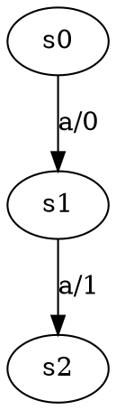

# Java-LSharp
This Java project contains an implementation of the L# algorithm.
The main code for this algorithm can be found in [this](https://gitlab.science.ru.nl/sws/lsharp) GitHub repository, which is written in the Rust programming language.

## Run with Docker

With Docker running, build and run the project from the repository root:

```bash
docker build -t nclsharp . && docker run --rm nclsharp
```

The image builds Java 21 dependencies and the pinned Hybrid-ADS revision automatically.
You do not need Java, Gradle, CMake, `init.sh`, or an initialized submodule on the host.
The first build needs internet access to download the build dependencies.

By default, this runs the current `Main` configuration: NCLSharp on
`src/main/resources/all_FSMs/49.dot`, using Hybrid-ADS for the full hypothesis
and random words for component testing. Results are printed to the terminal.
The command-line model and oracle options described below are not currently
parsed by `Main`.

To run the full benchmark and retrieve its CSV after it finishes:

```bash
docker run --name nclsharp-benchmark nclsharp institute.teias.Benchmark
docker cp nclsharp-benchmark:/opt/nclsharp/test_results.csv ./docker_test_results.csv
docker rm nclsharp-benchmark
```

The benchmark runs NCLSharp and CLSharp with Hybrid-ADS, targeting three
successful repetitions of each algorithm per model. It can take a long time.

## Requirements for running without Docker
Ensure your machine supports Java 21 or higher. You can verify the installation by executing the following command:

```bash
java -version
```

Also ensure that the `make` and `cmake` commands are installed. Run the following commands to verify this:
```bash
make -version
cmake -version
```

## Initialize
We used [this](https://github.com/Jaxan/hybrid-ads) submodule to use test Oracle `hybrid-ads`.
To load it, just run the following command:

```bash
chmod +x ./init.sh && ./init.sh
```

## Running Instructions
The experiment files, which are taken from the Rust project, are located in folder `src/main/resources/experimentModels`.
If you want to create your own custom file, simply create a file named `custom.dot`
(replace "custom" with your preferred name) and place it in the above folder.
Your `custom.dot` file format should be as follows:


Ensure that your custom Mealy machine is complete and includes a transition for every input symbol.
Additionally, the first line of your `custom.dot` file should represent one of the initial state's transition (similar to `s0` in the example above!).

To run the algorithm on your own `custom.dot` file, just run the following command:
```bash
./gradlew run --args="-f=custom.dot -eq=hads -r2=ads -r3=ads"
```
* Set `-f` value to your experiment model file name.
* Set `-eq` value to your preferred test oracle type. It must be one of the following values: `hads`(default), `perfect`, `rand_walk`, or `rand_words`.
* Set `-r2` value to your preferred rule 2 policy. It must be one of the following values: `nothing`, `sep_seq` or `ads`(default).
* Set `-r3` value to your preferred rule 3 policy. It must be one of the following values: `sep_seq` or `ads`(default).
* If you want to place your `custom.dot` file in your own folder, just set the `-fo` argument value to your folder path. The default folder path is `src/main/resources/experimentModels`.

## Create Benchmarks
We ran the algorithm on each of our models 100 times and saved the results in the file `results.csv`.
To recreate the results, execute the following command: (The complete execution of this command may take about two or three hours!)

```bash
./gradlew runBenchmark
```
